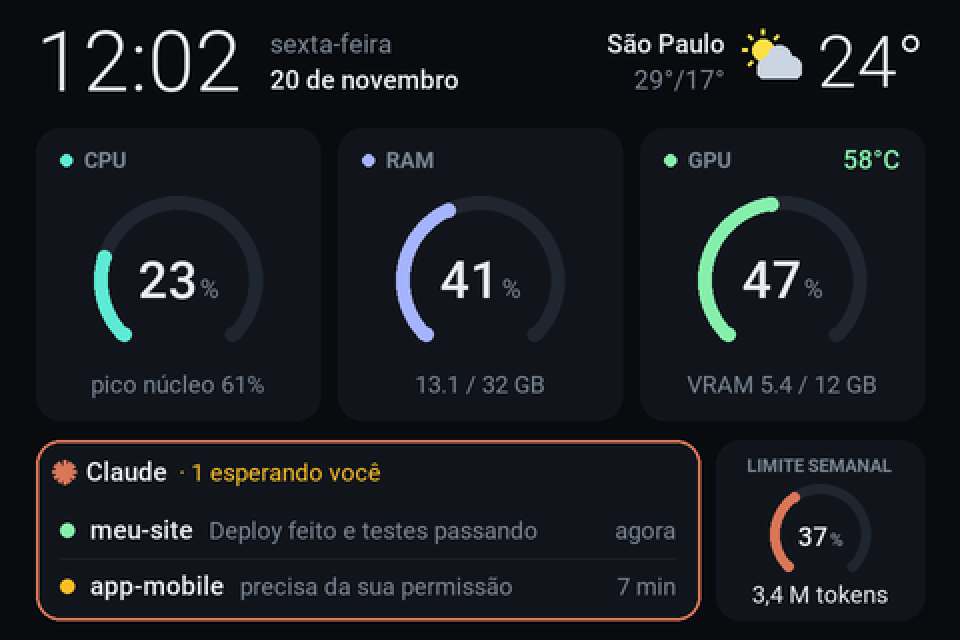
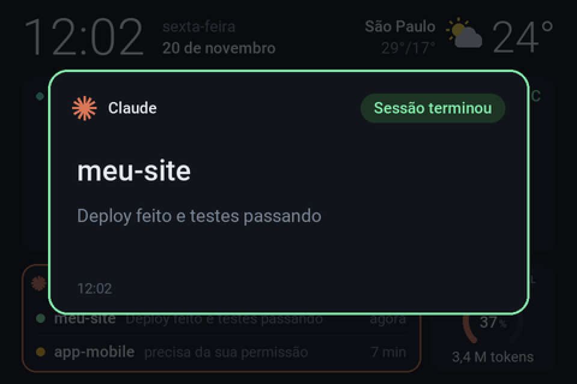
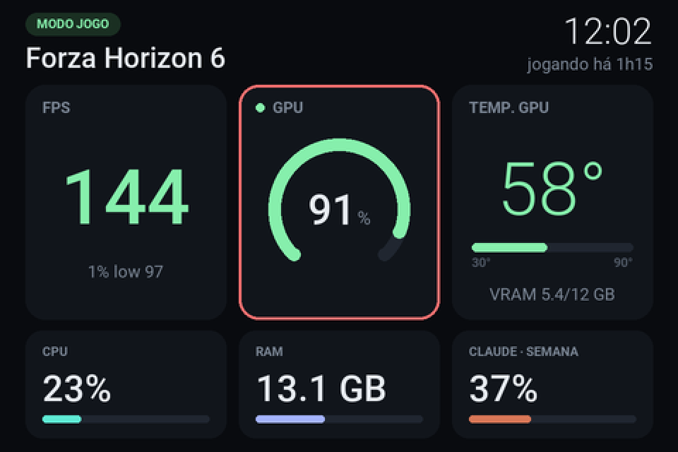

# Turing Screen Dashboard

Um painel limpo para a **Turing Smart Screen 3.5"** (a telinha USB que fica dentro do gabinete), feito em Python em cima da biblioteca [turing-smart-screen-python](https://github.com/mathoudebine/turing-smart-screen-python).

Mostra CPU, RAM e GPU, o clima da sua cidade, avisos do **Claude Code** quando uma sessão termina ou precisa de você, e troca sozinho para um **modo jogo** com FPS quando você abre um jogo.

| Painel | Aviso do Claude | Modo jogo |
|---|---|---|
|  |  |  |

## O que tem

- **Hora, data e clima** da sua cidade ([Open-Meteo](https://open-meteo.com), sem chave de API).
- **CPU, RAM e GPU** em medidores; temperatura da GPU colorida (verde, amarelo a partir de 60°, vermelho a partir de 78°). O cartão da GPU ganha **borda vermelha acima de 80%** de uso.
- **Notificações do Claude Code**: as últimas sessões que terminaram (verde) ou que estão esperando você (amarelo). Quando chega uma nova, um aviso grande aparece por cima da tela por 8 segundos.
- **Uso do Claude**: % do limite semanal e tokens gastos na semana (desde terça 10h).
- **Modo jogo automático**: detecta jogos da Steam, Xbox, Epic, GOG, Riot, Ubisoft e EA (ou qualquer programa em tela cheia usando a GPU) e mostra FPS, 1% low, GPU e temperatura em destaque.
- Leve: só redesenha o que muda (~5% de um núcleo) e se reconecta sozinho se a tela desconectar ou o PC voltar do sono.

## Requisitos

- Windows 10/11
- Turing Smart Screen 3.5" (**revisão A**, aparece como `USB35INCHIPSV2` no Gerenciador de Dispositivos)
- Python 3.10+
- GPU NVIDIA para uso/temperatura da GPU (sem NVIDIA o resto funciona)

> Feche o app original da tela (**UsbMonitor**) e tire ele da inicialização do Windows. Ele segura a porta COM e nada mais consegue falar com a tela.

## Instalação

```powershell
git clone --recurse-submodules https://github.com/scheinchris/turing-screen-dashboard.git
cd turing-screen-dashboard
python -m venv .venv
.\.venv\Scripts\python.exe -m pip install -r requirements.txt
copy config.example.json config.json
```

Edite o `config.json` com a sua cidade (latitude/longitude) e, se quiser, a porta COM (`"AUTO"` tenta achar sozinha).

Veja como vai ficar sem precisar da tela:

```powershell
.\.venv\Scripts\python.exe screen.py --preview previa.png
```

Rodar na tela: dois cliques em `iniciar-tela.vbs` (sem janela). Para parar: `parar-tela.cmd`.

Para iniciar junto com o Windows, coloque um atalho do `iniciar-tela.vbs` na pasta que abre com `Win+R` → `shell:startup`.

## Notificações do Claude Code

```powershell
.\.venv\Scripts\python.exe instalar_hooks.py
```

Isso adiciona dois hooks em `~/.claude/settings.json` (com backup): **Stop** (sessão terminou) e **Notification** (sessão esperando permissão ou resposta). Cada evento vira uma linha em `~/.claude/turing-screen/events.jsonl`, que a tela lê. Vale para as sessões abertas depois disso.

## Uso do Claude (limite semanal e tokens)

- **Tokens**: somados a partir das conversas salvas em `~/.claude/projects` (entrada + saída + escrita de cache), desde a última terça às 10h.
- **% do limite**: a tela tenta ler o valor real a cada 5 minutos usando o login do Claude Code salvo no PC. Esse endereço **não é oficial** e pode mudar; ele só funciona enquanto o login do Claude Code de terminal estiver válido. Quando não consegue, a tela **estima** o % a partir dos tokens, calibrada pela última leitura real, e mostra `≈` antes do número.

## FPS no modo jogo

O FPS vem do [PresentMon](https://github.com/GameTechDev/PresentMon) (ferramenta oficial da Intel, roda escondido):

1. Baixe o `PresentMon-x.y.z-x64.exe` na página de releases e salve como `tools\PresentMon.exe`.
2. Para ler o FPS sem rodar nada como administrador, adicione seu usuário ao grupo **Usuários de log de desempenho**. Em um PowerShell **como administrador**:

   ```powershell
   Add-LocalGroupMember -SID S-1-5-32-559 -Member $env:USERNAME
   ```

3. Saia e entre de novo no Windows.

Sem isso, o cartão de FPS mostra "sem permissão" e o resto do modo jogo funciona normalmente.

## Configuração (`config.json`)

| Chave | Padrão | O que faz |
|---|---|---|
| `com_port` | `"AUTO"` | Porta da tela, ex.: `"COM4"` |
| `brightness` | `30` | Brilho em %. A rev. A esquenta acima de ~50% |
| `city`, `lat`, `lon`, `timezone` | São Paulo | Cidade do clima |
| `gpu_alert_percent` | `80` | Uso de GPU que deixa a borda vermelha |
| `overlay_seconds` | `8` | Tempo do aviso do Claude por cima da tela |
| `event_max_age_hours` | `12` | Notificações mais velhas que isso somem |

Jogos que não forem detectados (ou programas detectados por engano) podem ser ajustados nas listas `LIBRARIES`, `KNOWN` e `NOT_GAMES` em `game_detect.py`.

## Ferramentas

- `teste-pixels.py`: mostra telas de cor sólida. Se um pixel errado aparece em todas as cores no mesmo lugar, é defeito do painel; se não, é software.

## Créditos e licença

Usa a biblioteca [turing-smart-screen-python](https://github.com/mathoudebine/turing-smart-screen-python) de Matthieu Houdebine (GPL-3.0), incluída como submódulo. Fontes Roboto (Apache 2.0) vêm dessa biblioteca.

Licença: **GPL-3.0**. Projeto independente, sem ligação com a Turing, a Anthropic, a NVIDIA ou a Intel.
